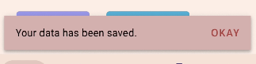

# Lumen Interaction Design

- **Unit**: ICTE3002 — Human Computer Interface
- **Study Period**: 2024 Trimester 1A
- **Degree Programme**: Bachelor of Information Technology — Awarded with Distinction by Curtin University
- **Overall Unit Mark**: 71 (Distinction)

<table>
  <thead>
    <tr>
      <th colspan="6">Curtin University &bull; Bachelor of Information Technology (Awarded with Distinction &bull; CWA 82.19)</th>
    </tr>
  </thead>
  <tbody>
    <tr align="center" style="font-weight: bold; background-color: #f6f8fa;">
      <td>2022 T3A</td>
      <td>2023 T1A</td>
      <td>2023 T2A</td>
      <td>2023 T3A</td>
      <td>2024 T1A</td>
      <td>2024 T2A</td>
    </tr>
    <tr>
      <td valign="top">
        <abbr title="Fundamentals of Programming (92 HD)"><b>COMP1005</b></abbr> 
        &bull; <a href="https://github.com/honneground/COMP1005-Vampire-Ecosystem-Simulation">Vampire Eco</a>         &bull; <a href="https://github.com/honneground/COMP1005-Vehicle-Emissions-Analyzer">Emissions</a>         <abbr title="Computer Systems (83 HD)">COMP2000</abbr> 
        <abbr title="Linear Algebra and Statistics for Engineers (71 D)">MATH1015</abbr> 
        <abbr title="Fundamental Concepts of Data Security (73 D)">ISEC2001</abbr>
      </td>
      <td valign="top">
        <abbr title="Data Structures and Algorithms (89 HD)"><b>COMP1002</b></abbr> 
        &bull; <a href="https://github.com/honneground/COMP1002-StudyHelp-Academic-Network">StudyHelp</a>         &bull; <a href="https://github.com/honneground/COMP1002-Advanced-Data-Structures-and-Visualizer">Visualizer</a>         <abbr title="Unix and C Programming (90 HD)"><b>COMP1000</b></abbr> 
        &bull; <a href="https://github.com/honneground/COMP1000-Terminal-Maze-Survival-Game">Maze Survival</a>         &bull; <a href="https://github.com/honneground/COMP1000-Terminal-Maze-Darkness-Game">Maze Darkness</a>         &bull; <a href="https://github.com/honneground/COMP1000-Bookstore-Transaction-Simulator">Bookstore</a>         <abbr title="Introduction to Software Engineering (95 HD)"><b>ISAD1000</b></abbr> 
        &bull; <a href="https://github.com/honneground/ISAD1000-Software-Testing-and-Pocket-Beast-Game">Pocket Beast</a>         <abbr title="Integrating Indigenous Science and STEM (73 D)">NPSC1003</abbr>
      </td>
      <td valign="top">
        <abbr title="Unix Systems Programming (88 HD)"><b>COMP2002</b></abbr> 
        &bull; <a href="https://github.com/honneground/COMP2002-Parallel-Directory-File-Calculator">Dir Calculator</a>         <abbr title="Operating Systems (80 HD)"><b>COMP2006</b></abbr> 
        &bull; <a href="https://github.com/honneground/COMP2006-Customer-Queue-Concurrency-Simulation">Queue Sim</a>         <abbr title="Computer Communications (75 D)">CNCO2000</abbr> 
        <abbr title="Mobile Cloud Computing (79 D)">CNCO3003</abbr>
      </td>
      <td valign="top">
        <abbr title="Database Systems (80 HD)"><b>ISYS2014</b></abbr> 
        &bull; <a href="https://github.com/honneground/ISYS2014-Relational-Database-Management-System">FootyStats DB</a>         <abbr title="Quantitative Techniques for Business (87 HD)"><b>ECOM2001</b></abbr> 
        &bull; <a href="https://github.com/honneground/ECOM2001-Econometric-Statistical-Analysis-R">Econometric R</a>         <abbr title="Managing Social Media Platforms (69 C)">MKTG2006</abbr> 
        <abbr title="Computing Topics (61 C)">COMP2005</abbr>
      </td>
      <td valign="top" style="background-color: #f1f8ff; border: 2px solid #0969da;">
        <abbr title="Financial Decision Making (93 HD)"><b>ACCT1002</b></abbr> 
        &bull; <a href="https://github.com/honneground/ACCT1002-Financial-Decision-Calculators">Finance Tools</a>         <abbr title="Human Computer Interface (71 D)"><b>ICTE3002</b></abbr> 
        &bull; <b>&#128073; Lumen UI</b>         <abbr title="Engineering Management and Professional Practice (79 D)"><b>MGMT3000</b></abbr> 
        &bull; <a href="https://github.com/honneground/MGMT3000-Phone-Router-Repurposing-Design">Phone Router</a>         <abbr title="Distributed Networks (83 HD)">CNCO3000</abbr>
      </td>
      <td valign="top">
        <abbr title="Capstone Computing Project 1 (94 HD)"><b>ISAD3000</b></abbr> 
        &bull; <a href="https://github.com/honneground/ISAD3000-CurtinSG-App-Design">CurtinSG UI</a>         <abbr title="Capstone Computing Project 2 (95 HD)"><b>ISAD3001</b></abbr> 
        &bull; <a href="https://github.com/honneground/ISAD3001-CurtinSG-Student-App">CurtinSG App</a>         <abbr title="Advanced Computer Communications (88 HD)"><b>CNCO3002</b></abbr> 
        &bull; <a href="https://github.com/honneground/CNCO3002-Multi-Service-Socket-Server">Socket Server</a>         <abbr title="Accounting - The Fundamentals of Business (93 HD)">ACCT2013</abbr>
      </td>
    </tr>
  </tbody>
</table>

## Assignment context and constraints

The assignment required a user-centred interactive-system design, supported by research, requirements, low- and high-fidelity prototypes, evaluation and a demonstration. The team developed Lumen, a proposed health and wellbeing interface addressing fatigue and everyday activity through connected-device concepts.

The deliverable explains the problem, user needs and design reasoning, shows prototype iterations and applies usability and visual design principles.

## My contribution

I worked on design thinking, software lifecycle/Agile application, final high-fidelity prototype polishing and the raw demonstration video. The team collaborated on user personas and low/high-fidelity prototype iterations.

## Deliverables

- [Design process and selected interface examples](docs/design-process.md)
- Low- and high-fidelity prototype iterations
- User needs, usability considerations and evaluation-driven refinement
- Final prototype demonstration

The recorded final high-fidelity design is [Lumen High-Fidelity Prototype Version 2](https://www.figma.com/file/NHon2ITf0nqK9M1z0bO9e8/Lumen-%28High-Fidelity-Prototype%29-Version-2). Selected images are included locally so the visual work can also be explored in this repository.

---

## Portfolio note

This Git repository was created retrospectively from the original project code, with assistance from OpenAI Codex and Antigravity in curating the repository and writing this README for publication. The initial commit timestamp is backdated to the original coursework submission date, followed by the final release commit.

