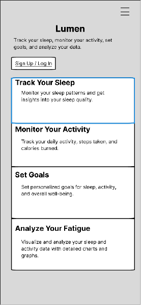
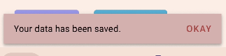
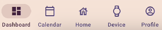
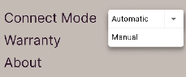
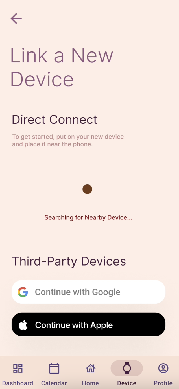
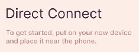

# Design Process and Interface Examples

## From needs to prototype

The team documented user personas, pain points, functional/non-functional requirements and a design-thinking process. Low-fidelity layouts were iterated before high-fidelity screens were polished. The final prototype groups Home, Dashboard, Calendar and Device functions around a consistent visual language.

## Interaction and refinement

The prototype illustrates immediate activity feedback, familiar navigation, device-selection controls, reminders and setup help. These examples connect the interface choices to the team's usability review.

## My role and collaboration

My work includes design thinking, Agile/lifecycle application, final high-fidelity polishing and raw video capture, with shared work on personas and prototype iterations. Other team members contributed requirements, evaluation, visual-design explanation, narration, editing and publishing.
